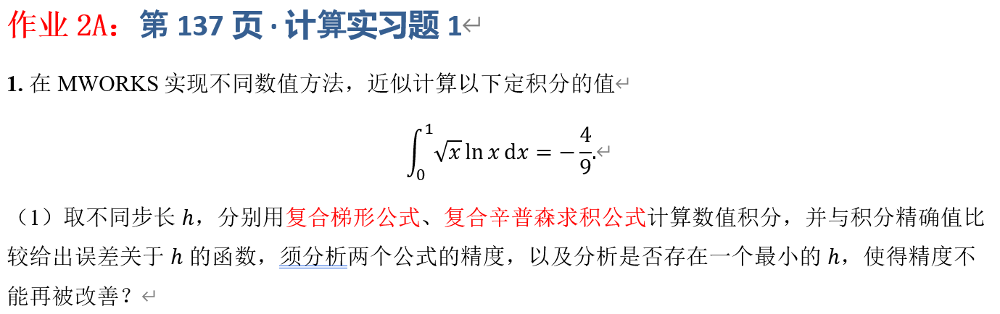

## 一、实验目的



## 二、理论基础与公式推导

### 2.1 精确积分值

令 $ f(x)=\sqrt{x}\ln x\ $。由于 $ \lim_{x\to0^+}\sqrt{x}\ln x=0, $ 可定义 $f(0)=0$ ，使得被积函数在区间 $[0,1]$ 上连续。

采用分部积分 $\int u\ dv=uv-\int v\ du $，取

$$
u=\ln x,\quad \mathrm dv=x^{1/2}\mathrm dx,\quad\quad \mathrm du=\frac1x\mathrm dx,\quad v=\frac23x^{3/2}.

$$

于是

$$
\begin{aligned}
I&=\int_0^1x^{1/2}\ln x\,\mathrm dx\\
&=\left.\frac23x^{3/2}\ln x\right|_0^1-\frac23\int_0^1x^{1/2}\,\mathrm dx\\
&=0-\left.\frac49x^{3/2}\right|_0^1 \\
&=-\frac49.
\end{aligned}

$$

### 2.2 复合梯形公式推导

#### 2.2.1 单区间梯形公式

在区间 $[a,b]$ 上，用经过端点 $(a,f(a))$ 、$(b,f(b))$ 的一次插值多项式 $P_1(x)=f(a)\frac{b-x}{b-a}+f(b)\frac{x-a}{b-a}$ 近似 $f(x)$, 对 $P_1(x)$ 积分

$$
\int_a^bP_1(x)\,\mathrm dx
=\frac{f(a)}{b-a}\int_a^b(b-x)\,\mathrm dx + \frac{f(b)}{b-a}\int_a^b(x-a)\,\mathrm dx=\frac{b-a}{2}[f(a)+f(b)]

$$

则

$$
\boxed{\int_a^bf(x)\,\mathrm dx\approx\frac{b-a}{2}[f(a)+f(b)]}.

$$

#### 2.2.2 复合梯形公式

为了提高精度，将 $[a,b]$ 等分为 $n$ 个小区间，步长为 $h=\frac{b-a}n$,则划分的节点为$ x_i=a+ih,\quad i=0,1,\ldots,n. $

在每个小区间 $[x_i,x_{i+1}]$ 上应用单区间梯形公式：

$$
\int_{x_i}^{x_{i+1}}f(x)\,\mathrm dx\approx\frac h2[f(x_i)+f(x_{i+1})].

$$

对全部小区间求和：

$$
I_T(h)\approx\frac h2\sum_{i=0}^{n-1}[f(x_i)+f(x_{i+1})].

$$

展开后，内部节点各出现两次，首末节点各出现一次，整理得

$$
\boxed{ I_T(h)=h\left[ \frac12f(x_0)+\sum_{i=1}^{n-1}f(x_i)+\frac12f(x_n)\right]. }

$$

本题 $x_i=ih,\quad f(0)=f(1)=0$，所以

$$
\boxed{I_T(h)=h\sum_{i=1}^{n-1}\sqrt{ih}\ln(ih)}.

$$

#### 2.2.3 梯形公式误差

当 $f\in C^2[a,b]$ 时，复合梯形公式的误差为

$$
E_T(h)=I-I_T(h)=-\frac{(b-a)h^2}{12}f''(\xi),\quad \xi\in(a,b),

$$

因此在相应光滑性条件下具有二阶精度，即通常有 $E_T(h)=O(h^2)$。

但本题$ f'(x)=\frac{\ln x+2}{2\sqrt{x}},\qquad f''(x)=-\frac{\ln x}{4x^{3/2}}.$ 那么当 $x\to0^+ $ 时，$f''(x)$ 无界，经典误差定理的前提不成立，实际收敛阶应根据实验结果判断。

### 2.3 复合辛普森公式推导

#### 2.3.1 单组辛普森公式

取区间 $[a,b]$上三个等距节点 $ x_0=a,\quad x_1=\frac{a+b}{2},\quad x_2=b,\quad h=\frac{b-a}{2}. $

用二次拉格朗日插值多项式 $ P_2(x)=f(x_0)L_0(x)+f(x_1)L_1(x)+f(x_2)L_2(x)$ 逼近函数，其中

$$
L_0(x)=\frac{(x-x_1)(x-x_2)}{(x_0-x_1)(x_0-x_2)},

$$

$$
L_1(x)=\frac{(x-x_0)(x-x_2)}{(x_1-x_0)(x_1-x_2)},

$$

$$
L_2(x)=\frac{(x-x_0)(x-x_1)}{(x_2-x_0)(x_2-x_1)}.

$$

令 $x=x_0+ht$ ，则 $t\in[0,2]$，三个基函数化为

$$
L_0(t)=\frac{(t-1)(t-2)}2,\quad L_1(t)=-t(t-2),\quad L_2(t)=\frac{t(t-1)}2.

$$

其积分分别为

$$
\int_0^2L_0(t)\,\mathrm dt=\frac13,\quad \int_0^2L_1(t)\,\mathrm dt=\frac43,\quad \int_0^2L_2(t)\,\mathrm dt=\frac13.

$$

由于 $\mathrm dx=h\,\mathrm dt$，

$$
\begin{aligned}
\int_{x_0}^{x_2}P_2(x)\,\mathrm dx
&=h\int_0^2P_2(x_0+ht)\,\mathrm dt\\
&=\frac h3[f(x_0)+4f(x_1)+f(x_2)].
\end{aligned}

$$

又因 $2h=b-a$，可写为

$$
\boxed{
\int_a^bf(x)\,\mathrm dx\approx
\frac{b-a}{6}\left[
f(a)+4f\left(\frac{a+b}{2}\right)+f(b)
\right]}.

$$

#### 2.3.2 复合辛普森公式

将 $[a,b]$ 等分为 $n$ 个小区间，要求 $n$ 为偶数。令$ h=\frac{b-a}n,\qquad x_i=a+ih.$

每两个小区间组成一组，在区间 $[x_{2j},x_{2j+2}]$ 上应用单组公式：

$$
\begin{aligned}
\int_{x_{2j}}^{x_{2j+2}}f(x)\,\mathrm dx
\approx\frac h3[&f(x_{2j})+4f(x_{2j+1})\\
&+f(x_{2j+2})].
\end{aligned}

$$

将 $n/2$ 组的公式相加：端点系数为 \(1\)，奇数下标节点系数为 \(4\)，内部偶数下标节点系数为 \(2\)。因此

$$
\boxed{
\begin{aligned}
I_S(h)=\frac h3\bigg[&
f(x_0)+f(x_n)\\
&+4\sum_{\substack{i=1\\i\text{为奇数}}}^{n-1}f(x_i)\\
&+2\sum_{\substack{i=2\\i\text{为偶数}}}^{n-2}f(x_i)
\bigg].
\end{aligned}}

$$

本题首末端点函数值均为零，故

$$
\boxed{
\begin{aligned}
I_S(h)=\frac h3\bigg[&
4\sum_{\substack{i=1\\i\text{为奇数}}}^{n-1}
\sqrt{ih}\ln(ih)\\
&+2\sum_{\substack{i=2\\i\text{为偶数}}}^{n-2}
\sqrt{ih}\ln(ih)\bigg].
\end{aligned}}

$$

#### 2.3.3 辛普森公式误差

若 $f\in C^4[a,b]$，则复合辛普森公式满足

$$
I-I_S(h)=-\frac{(b-a)h^4}{180}f^{(4)}(\xi),\quad \xi\in(a,b),

$$

因此通常有 $E_S(h)=O(h^4)$。对光滑函数而言，步长减半时，误差通常约缩小到原来的 $1/16$。

但本题函数在 $x=0$ 处不具有连续的四阶导数，所以不能直接用该定理断言本题实际误差为 $O(h^4)$。

## 三、误差定义与实验方案

设精确值 $ I=-4/9$，梯形与辛普森近似值分别为$ I_T(h)$ 、$ I_S(h)$ 。绝对误差定义为

$$
\boxed{E_T(h)=\left|I_T(h)+\frac49\right|}, \qquad \boxed{E_S(h)=\left|I_S(h)+\frac49\right|}.

$$

取

$$
n=4,8,16,32,64,128,256,512,1024,2048,4096,\quad h=\frac1n.

$$

所有 $ n $ 均为偶数，满足复合辛普森公式的使用条件。

相邻两次计算的实验收敛阶定义为

$$
\boxed{p=\frac{\ln(E(h)/E(h/2))}{\ln2}}.

$$

若误差满足 $E(h)\approx Ch^p$，则该式可用于估计实际收敛阶。

## 四、MWORKS 程序实现

```julia
using Printf
using TyPlot

# 被积函数：在 x=0 处使用连续延拓值 f(0)=0
function f(x)
    if x == 0.0
        return 0.0
    else
        return sqrt(x) * log(x)
    end
end

# 复合梯形公式
function composite_trapezoid(n)
    h = 1.0 / n
    result = 0.5 * f(0.0) + 0.5 * f(1.0)

    for i in 1:(n - 1)
        result += f(i * h)
    end

    return h * result
end

# 复合辛普森公式，n 必须为偶数
function composite_simpson(n)
    if n % 2 != 0
        error("辛普森公式要求 n 为偶数")
    end

    h = 1.0 / n
    result = f(0.0) + f(1.0)

    for i in 1:(n - 1)
        if i % 2 == 1
            result += 4.0 * f(i * h)
        else
            result += 2.0 * f(i * h)
        end
    end

    return h * result / 3.0
end

# 精确值与绝对误差
I_exact = -4.0 / 9.0
absolute_error(I_approx) = abs(I_approx - I_exact)

# 主实验
n_values = [4, 8, 16, 32, 64, 128,
            256, 512, 1024, 2048, 4096]

trap_errors = Float64[]
simpson_errors = Float64[]

println("精确值 I = ", I_exact)
@printf("%8s %12s %18s %14s %18s %14s\n",
        "n", "h", "梯形近似值", "梯形误差",
        "辛普森近似值", "辛普森误差")

for n in n_values
    h = 1.0 / n
    I_trap = composite_trapezoid(n)
    I_simpson = composite_simpson(n)

    E_trap = absolute_error(I_trap)
    E_simpson = absolute_error(I_simpson)

    push!(trap_errors, E_trap)
    push!(simpson_errors, E_simpson)

    @printf("%8d %12.5e %18.10f %14.5e %18.10f %14.5e\n",
            n, h, I_trap, E_trap, I_simpson, E_simpson)
end

# 实验收敛阶
println("\n相邻步长下的实验收敛阶")
@printf("%8s %18s %18s\n",
        "n", "梯形实验阶", "辛普森实验阶")

for k in 2:length(n_values)
    p_trap = log(trap_errors[k - 1] / trap_errors[k]) / log(2.0)
    p_simpson = log(simpson_errors[k - 1] / simpson_errors[k]) / log(2.0)
    @printf("%8d %18.6f %18.6f\n",
            n_values[k], p_trap, p_simpson)
end

# 绘制误差曲线
h_values = 1.0 ./ n_values
TyPlot.figure()
TyPlot.loglog(h_values, trap_errors, "o-",
              label="Composite Trapezoid")
TyPlot.hold("on")
TyPlot.loglog(h_values, simpson_errors, "s-",
              label="Composite Simpson")
TyPlot.xlabel("Step size h")
TyPlot.ylabel("Absolute error")
TyPlot.title("Quadrature Error versus Step Size")
TyPlot.legend()
TyPlot.grid(true)
```

### 程序说明

1. 在 $x=0$ 处直接返回 $0$，避免计算 $\ln0$。
2. 梯形公式的首末节点权重为 $1/2$，内部节点权重为 $1$，最终乘以 $h$。
3. 辛普森公式的首末节点权重为 $1$，奇数下标节点权重为 $4$，内部偶数下标节点权重为 $2$，最终乘以 $h/3$。
4. 程序计算两种方法的绝对误差，并用相邻步长误差比估计实验收敛阶。
5. 双对数误差图可用于观察误差随步长变化的趋势。

## 五、实验结果

下表为参考结果。正式提交时，应以 MWORKS 实际运行输出为准。

---

$n$             $h$                 梯形公式绝对误差               辛普森公式绝对误差
-------------------------------------------------------------------------------------

4              0.25   $8.6340\times10^{-2}$   $4.8661\times10^{-2}$

8             0.125   $3.6354\times10^{-2}$   $1.9692\times10^{-2}$

16            0.0625   $1.4970\times10^{-2}$   $7.8417\times10^{-3}$

32           0.03125   $6.0550\times10^{-3}$   $3.0833\times10^{-3}$

64          0.015625   $2.4138\times10^{-3}$   $1.2000\times10^{-3}$

128         0.0078125   $9.5079\times10^{-4}$   $4.6313\times10^{-4}$

256        0.00390625   $3.7081\times10^{-4}$   $1.7748\times10^{-4}$

512       0.001953125   $1.4341\times10^{-4}$   $6.7606\times10^{-5}$
1024      0.0009765625   $5.5066\times10^{-5}$   $2.5620\times10^{-5}$

2048     0.00048828125   $2.1015\times10^{-5}$   $9.6651\times10^{-6}$

4096    0.000244140625   $7.9777\times10^ {-6}$   $3.6318\times10^ {-6}$

---

两种方法的误差均随步长减小而下降；在本次测试范围内，辛普森公式的误差始终小于梯形公式。

## 六、实验结果分析

### 6.1 步长的影响

随着 $n$ 增大，$h=1/n$ 逐渐减小，两种方法的绝对误差均下降。更多的子区间通常能够提高局部近似效果，但误差下降的速度取决于被积函数的性质，并不一定遵循固定比例。

### 6.2 两种公式的精度比较

对满足相应光滑性条件的函数，复合梯形公式通常为二阶精度，复合辛普森公式通常为四阶精度。但本题的函数在 $x=0$ 处不具有连续的二阶和四阶导数，经典误差定理的前提不成立。

以参考误差为例，从 $n=1024$加倍到 $n=2048$，梯形公式误差比约为 $2.62$，辛普森公式误差比约为 $2.65$，对应的实验收敛阶分别约为

$$
p_T\approx\log_2(2.62)\approx1.39,\qquad p_S\approx\log_2(2.65)\approx1.41.

$$

这与光滑函数下的二阶、四阶理论阶数不同，说明端点非光滑性影响了实际收敛表现。当前测试中辛普森公式的误差更小，但不应据此宣称本题具有四阶收敛。

### 6.3 是否存在使精度不能继续改善的最小步长？

在精确算术下，减小步长通常会使数值求积更接近积分值。但计算机使用有限精度浮点数，实际总误差受到以下因素影响：

1. **浮点舍入误差：** 函数计算、乘法和加法都会产生微小舍入误差。
2. **累积误差：** 节点数增加后，求和运算次数增多，舍入误差可能累积。
3. **截断误差与舍入误差的平衡：**

$$
_{\mathrm{total}}(h)\approx E_{\mathrm{trunc}}(h)+E_{\mathrm{round}}(h).

$$

截断误差通常随步长减小而下降，但舍入误差不会无限减小。

因此，实际计算中可能出现误差下降逐渐变慢、趋于停滞，甚至开始增大的现象。此时可能存在一个使总误差较小的最优步长范围，但它不是固定不变的常数，而取决于函数、求积方法、浮点精度及程序实现。

本实验测试到 $n=4096$ 时，误差仍在下降，因此目前不能确定最优步长。可以继续增大 $n$，观察误差是否开始停滞或增大。

### 6.4 实验局限

本题的函数在 $x=0$ 处可以连续延拓，但高阶导数并不都有限。因此，分析误差时不能只引用经典误差阶数，还需要检查其光滑性条件，并结合实验数据判断实际收敛行为。

## 七、实验结论

本实验在 MWORKS 中实现了复合梯形求积公式和复合辛普森求积公式，并通过改变步长计算定积分

$$
\int_0^1\sqrt{x}\ln x\,\mathrm dx=-\frac49.

$$

实验表明，随着步长减小，两种方法的绝对误差均逐渐下降；在本次测试范围内，辛普森公式取得了更小的绝对误差。从理论上看，梯形公式对于二阶导数连续的函数通常具有二阶精度，辛普森公式对于四阶导数连续的函数通常具有四阶精度。但本题被积函数在 $x=0$ 处不满足这些高阶光滑性条件，因此实际收敛阶不能直接由经典误差定理确定。

此外，步长并非越小越好。步长过小时，舍入误差和累积误差可能影响结果，导致精度改善停滞甚至下降。实际计算需要综合考虑截断误差、舍入误差和计算成本，选择合适的步长。
