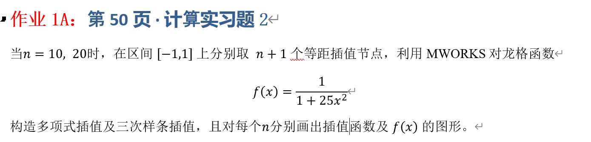
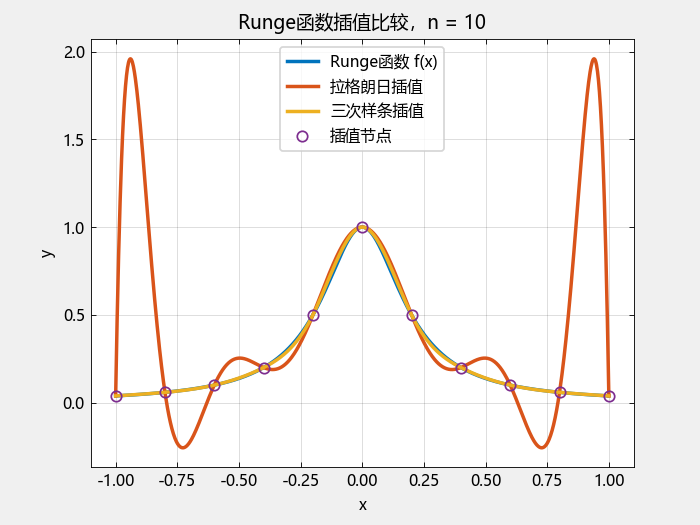
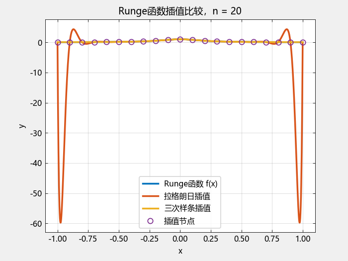

## 一、实验目的



## 二、理论基础与推导

### 2.1 插值问题

设函数 $f(x)$ 在区间 $[a,b]$ 上给定，选取 $n+1$ 个互不相同的节点 $x_0,x_1,\ldots,x_n$。插值问题是在给定的函数空间中寻找函数 $F(x)$，使其满足 $F(x_i)=f(x_i)$，$i=0,\ldots,n$。本实验分别在全局多项式空间和三次样条空间中构造插值函数，使用的等距节点为 $x_i=-1+\frac{2i}{n}, i=0,1,\ldots,n.$

---

### 2.2 拉格朗日多项式插值

对于给定的 $n+1$ 个互异节点及其函数值，次数不超过 $n$ 的插值多项式唯一。拉格朗日形式通过基函数直接构造插值多项式，牛顿形式则通过差商逐项构造，两者表示同一个多项式。本实验的节点一次给定，采用拉格朗日形式可以直接体现各节点的插值条件，并使构造公式与程序实现逐项对应，因此选用拉格朗日插值。

#### 2.2.1 基本思想

记 $y_i=f(x_i)$。在次数不超过 $n$ 的多项式空间中，寻找满足 $P_n(x_i)=y_i, i=0,1,\ldots,n$ 的多项式。为分别满足各节点上的插值条件，先构造在其他节点处为零的多项式 $\prod_{j\ne i}(x-x_j)$，再除以其在 $x_i$ 处的值进行归一化，得到拉格朗日基函数$L_i(x)=\prod_{\substack{j=0\\j\ne i}}^n\frac{x-x_j}{x_i-x_j}.$

由节点互异可知，分母非零，且基函数满足 $L_i(x_j)=\begin{cases}1,&i=j,\\0,&i\ne j.\end{cases}$，以节点函数值为系数作线性组合，得到插值多项式：

$$
\boxed{
P_n(x)=
\sum_{i=0}^{n}
f(x_i)L_i(x)
}
$$

由于每个 $L_i(x)$ 的次数为 $n$，$P_n(x)$ 的次数不超过 $n$；在任一节点 $x_k$ 处，求和式中仅第 $k$ 项保留，故 $P_n(x_k)=y_k$，从而完成插值多项式的构造。

---

#### 2.2.2 插值误差

设 $f\in C^{n+1}[-1,1]$，记节点多项式 $\omega_{n+1}(x)=\prod_{i=0}^{n}(x-x_i)$。对于任意非节点的 $x$，令

$$
K=\frac{f(x)-P_n(x)}{\omega_{n+1}(x)},\qquad
\varphi(t)=f(t)-P_n(t)-K\omega_{n+1}(t).
$$

函数 $\varphi(t)$ 在 $n+1$ 个插值节点以及 $x$ 处均为零。反复应用罗尔定理，存在 $\xi\in(-1,1)$，使得

$$
0=\varphi^{(n+1)}(\xi)=f^{(n+1)}(\xi)-K(n+1)!.
$$

由此得到插值余项

$$
f(x)-P_n(x)
=
\frac{f^{(n+1)}(\xi)}
{(n+1)!}
\prod_{i=0}^{n}(x-x_i),
$$

其中 $\xi$ 随 $x$ 而变化。在插值节点处，误差为零。

由此可以看出，误差由高阶导数与节点乘积共同决定，不能仅凭节点数增加就断言误差减小。本实验将通过数值结果考察等距节点下提高插值次数的实际影响。

---

### 2.3 三次样条插值

三次样条插值在各相邻节点之间构造次数不超过三次的多项式，并通过节点处的光滑性条件将各段连接起来。

设插值节点为 $x_0<x_1<\cdots<x_n$，在每个小区间 $[x_i,x_{i+1}]$ 上构造多项式 $S_i(x)$，$i=0,\ldots,n-1$。

最终得到整个区间上的分段函数

$$
S(x)=
\begin{cases}
S_0(x),&x\in[x_0,x_1],\\
S_1(x),&x\in[x_1,x_2],\\
\vdots\\
S_{n-1}(x),&x\in[x_{n-1},x_n].
\end{cases}
$$

#### 2.3.1 插值与光滑性条件

每段多项式满足两端的插值条件

$$
S_i(x_i)=y_i,\qquad S_i(x_{i+1})=y_{i+1},\qquad i=0,\ldots,n-1.
$$

在内部节点处，要求一阶和二阶导数连续，即

$$
S_{i-1}'(x_i)=S_i'(x_i),\qquad
S_{i-1}''(x_i)=S_i''(x_i),\qquad i=1,\ldots,n-1.
$$

因此 $S\in C^2[-1,1]$。$n$ 段多项式共有 $4n$ 个待定系数，上述条件共有 $2n+2(n-1)=4n-2$ 个，故还需要两个边界条件来闭合方程组。

#### 2.3.2 边界条件的选择

常见的边界条件包括第一类边界条件，即指定两端的一阶导数；第二类边界条件，即指定两端的二阶导数；以及周期边界条件，即要求两端的函数值、一阶导数和二阶导数对应相等。其中，第二类边界条件取零时称为自然边界条件。

本实验以节点及其函数值作为构造插值函数的输入，采用自然边界条件 $S''(x_0)=S''(x_n)=0.$

该条件使曲线在两端的曲率为零。自然样条还具有一个整体的光滑性意义：在通过相同节点的 $C^2$ 函数中，它使二阶导数的平方积分最小。事实上，设 $g$ 为任意这样的函数，令 $v=g-S$，则 $v(x_i)=0$。由于每段上 $S_i^{(4)}=0$，分段积分两次可得

$$
\int_{-1}^{1}S''(x)v''(x)\,dx
=\sum_{i=0}^{n-1}\left[S_i''v'-S_i'''v\right]_{x_i}^{x_{i+1}}=0.
$$

这里含 $v$ 的边界项因 $v(x_i)=0$ 而消失，内部节点处含 $v'$ 的项因 $S''$ 连续而相消，区间两端的项则由自然边界条件消去。因此

$$
\int_{-1}^{1}(g'')^2\,dx
=\int_{-1}^{1}(S'')^2\,dx+\int_{-1}^{1}(v'')^2\,dx
\ge\int_{-1}^{1}(S'')^2\,dx.
$$

这说明自然边界对应于在满足插值条件的同时控制曲线整体弯曲程度的选择。

对于本题，原函数的导数为

$$
f'(x)=-\frac{50x}{(1+25x^2)^2},\qquad
f''(x)=\frac{50(75x^2-1)}{(1+25x^2)^3}.
$$

若采用第一类边界条件，则可取 $S'(-1)=25/338$、$S'(1)=-25/338$。本实验采用的自然边界则统一取端点二阶导数为零，而 $f''(\pm1)=3700/17576\approx0.210514$，两者的端点曲率存在差异。这一差异是分析样条端部误差时需要考虑的因素。由于 $f'(-1)\ne f'(1)$，本题也不具有周期连接所需的端点导数匹配关系。

---

### 2.4 三次样条插值公式推导

记 $M_i=S''(x_i)$，并令 $h_i=x_{i+1}-x_i$。

由于 $S_i(x)$ 的次数不超过三次，其二阶导数是次数不超过一次的多项式。由两端的二阶导数值，在区间 $[x_i,x_{i+1}]$ 上有

$$
S_i''(x)= M_i\frac{x_{i+1}-x}{h_i}+M_{i+1}\frac{x-x_i}{h_i}.
$$

对上式进行两次积分，将积分产生的一次多项式写成 $A_i(x_{i+1}-x)+B_i(x-x_i)$，得到

$$
S_i(x)=\frac{M_i(x_{i+1}-x)^3}{6h_i}
+\frac{M_{i+1}(x-x_i)^3}{6h_i}
+A_i(x_{i+1}-x)+B_i(x-x_i).
$$

代入两端的插值条件，有

$$
y_i=\frac{M_ih_i^2}{6}+A_ih_i,\qquad
y_{i+1}=\frac{M_{i+1}h_i^2}{6}+B_ih_i,
$$

从而

$$
A_i=\frac{y_i}{h_i}-\frac{M_ih_i}{6},\qquad
B_i=\frac{y_{i+1}}{h_i}-\frac{M_{i+1}h_i}{6}.
$$

将其代回，即得区间 $[x_i,x_{i+1}]$ 上的样条表达式：

$$
\boxed{
\begin{aligned}
S_i(x)
={}&
\frac{M_i(x_{i+1}-x)^3}{6h_i}+
\frac{M_{i+1}(x-x_i)^3}{6h_i}\\
&+
\left(
\frac{f(x_i)}{h_i}
-\frac{M_i h_i}{6}
\right)
(x_{i+1}-x)\\
&+
\left(
\frac{f(x_{i+1})}{h_i}
-\frac{M_{i+1}h_i}{6}
\right)
(x-x_i).
\end{aligned}
}
$$

因此，三次样条插值的关键在于求出各个节点处的二阶导数 $M_i$。

---

### 2.5 三次样条线性方程组

对上一节的表达式求导，得到小区间两端的斜率

$$
S_i'(x_i)=\frac{y_{i+1}-y_i}{h_i}-\frac{h_i}{6}(2M_i+M_{i+1}),
$$

$$
S_i'(x_{i+1})=\frac{y_{i+1}-y_i}{h_i}+\frac{h_i}{6}(M_i+2M_{i+1}).
$$

在内部节点 $x_i$ 处令 $S_{i-1}'(x_i)=S_i'(x_i)$，有

$$
\frac{y_i-y_{i-1}}{h_{i-1}}+\frac{h_{i-1}}{6}(M_{i-1}+2M_i)
=\frac{y_{i+1}-y_i}{h_i}-\frac{h_i}{6}(2M_i+M_{i+1}).
$$

将含 $M_{i-1},M_i,M_{i+1}$ 的项移至左端并整理，得到

$$
h_{i-1}M_{i-1}+ 2(h_{i-1}+h_i)M_i+ h_iM_{i+1}=6
\left[
\frac{f(x_{i+1})-f(x_i)}{h_i}-
\frac{f(x_i)-f(x_{i-1})}{h_{i-1}}
\right],
$$

其中 $i=1,2,\ldots,n-1$。

结合自然边界条件 $M_0=M_n=0$， 即可构造出关于 $M=[M_0,M_1,\ldots,M_n]^T$ 的线性方程组 $AM=b$。

本题采用等距节点，$h_i=h=2/n$，内部节点方程进一步化为

$$
\boxed{M_{i-1}+4M_i+M_{i+1}=\frac{6}{h^2}(y_{i+1}-2y_i+y_{i-1}),
\qquad i=1,\ldots,n-1.}
$$

消去已知的 $M_0=M_n=0$ 后，得到

$$
\begin{bmatrix}
4&1&&\\
1&4&\ddots&\\
&\ddots&\ddots&1\\
&&1&4
\end{bmatrix}
\begin{bmatrix}M_1\\M_2\\\vdots\\M_{n-1}\end{bmatrix}
=\frac{6}{h^2}
\begin{bmatrix}
y_2-2y_1+y_0\\
y_3-2y_2+y_1\\
\vdots\\
y_n-2y_{n-1}+y_{n-2}
\end{bmatrix}.
$$

系数矩阵为严格对角占优的三对角矩阵，因此非奇异，$M_1,\ldots,M_{n-1}$ 唯一确定。再由分段表达式可知，自然三次样条也唯一确定。

程序保留端点未知量，将 $M_0=0$ 和 $M_n=0$ 作为方程组的首、末两行，与上述消去端点后的方程组等价。求解后将 $M_i$ 代入样条表达式，即可计算任意 $x\in[-1,1]$ 处的插值结果。

---

## 三、算法设计

### 3.1 拉格朗日插值算法

对于给定的 $x$，首先计算每一个拉格朗日基函数 $L_i(x)= \prod_{j\neq i} \frac{x-x_j}{x_i-x_j},$ 然后计算 $P_n(x)=\sum_i f(x_i)L_i(x).$

具体步骤如下：

1. 在 $[-1,1]$ 上生成 $n+1$ 个等距节点；
2. 计算各节点处的函数值；
3. 对每一个测试点 $x$，计算所有拉格朗日基函数；
4. 将各基函数与对应节点函数值相乘并求和；
5. 得到拉格朗日插值结果。

---

### 3.2 三次样条插值算法

三次样条插值的具体步骤如下：

1. 生成等距节点 $x_0,\cdots,x_n$；
2. 计算节点函数值 $f(x_i)$；
3. 计算相邻节点间距 $h_i$；
4. 根据自然边界条件建立三次样条线性方程组；
5. 求解方程组得到节点二阶导数 $M_i$；
6. 根据测试点 $x$ 所在的节点区间选择对应的三次样条；
7. 计算三次样条插值结果。

---

## 四、MWORKS程序实现

本实验使用 MWORKS 中的 Julia 科学计算语言进行实现。数学推导中的节点下标从 0 开始，Julia 数组下标从 1 开始，因此 `nodes[i + 1]`、`values[i + 1]` 和 `M[i + 1]` 分别对应 $x_i$、$y_i$ 和 $M_i$。程序使用一般节点间距形式组装样条方程组，并通过 `A \ b` 求解节点二阶导数。

```julia
using LinearAlgebra
using TyPlot

# =========================
# 1. Runge函数
# =========================
function f(x)
    return 1.0 / (1.0 + 25.0 * x^2)
end


# =========================
# 2. 生成等距插值节点
# =========================
function interpolation_nodes(n)
    return collect(range(-1.0, 1.0, length=n + 1))
end


# =========================
# 3. 拉格朗日多项式插值
# =========================
function lagrange_interpolation(x, nodes, values)
    N = length(nodes)
    result = 0.0

    for i in 1:N
        Li = 1.0

        for j in 1:N
            if i != j
                Li *= (x - nodes[j]) / (nodes[i] - nodes[j])
            end
        end

        result += values[i] * Li
    end

    return result
end


# =========================
# 4. 求自然三次样条的二阶导数
# =========================
function cubic_spline(nodes, values)

    n = length(nodes) - 1

    h = [
        nodes[i + 1] - nodes[i]
        for i in 1:n
    ]

    # 构造线性方程组 A*M=b
    A = zeros(n + 1, n + 1)
    b = zeros(n + 1)

    # 自然边界条件
    # M_0 = 0, M_n = 0
    A[1, 1] = 1.0
    A[n + 1, n + 1] = 1.0

    # 内部节点
    for i in 2:n

        A[i, i - 1] = h[i - 1]

        A[i, i] = 2.0 * (
            h[i - 1] + h[i]
        )

        A[i, i + 1] = h[i]

        b[i] = 6.0 * (
            (values[i + 1] - values[i]) / h[i]
            -
            (values[i] - values[i - 1]) / h[i - 1]
        )
    end

    # 求解二阶导数 M
    M = A \ b

    return M
end


# =========================
# 5. 计算三次样条插值
# =========================
function spline_interpolation(x, nodes, values, M)

    n = length(nodes) - 1

    # 判断是否在插值区间内
    if x < nodes[1] || x > nodes[end]
        error("x is outside interpolation interval")
    end

    # 找到x所在区间
    i = searchsortedlast(nodes, x)

    if i == length(nodes)
        i -= 1
    end

    h = nodes[i + 1] - nodes[i]

    term1 =
        M[i] * (nodes[i + 1] - x)^3 / (6.0 * h)

    term2 =
        M[i + 1] * (x - nodes[i])^3 / (6.0 * h)

    term3 =
        (values[i] / h - M[i] * h / 6.0) *
        (nodes[i + 1] - x)

    term4 =
        (values[i + 1] / h - M[i + 1] * h / 6.0) *
        (x - nodes[i])

    return term1 + term2 + term3 + term4
end


# =========================
# 6. 计算测试网格上的最大绝对误差
# =========================
function max_error(y_true, y_approx)

    return maximum(
        abs.(y_true .- y_approx)
    )

end


# =========================
# 7. 主实验
# =========================

# 绘图使用较密的测试点
x_plot = collect(
    range(-1.0, 1.0, length=1001)
)

y_true = [
    f(x)
    for x in x_plot
]


for n in [10, 20]

    println()
    println("==============================")
    println("n = ", n)
    println("==============================")

    # 生成插值节点
    nodes = interpolation_nodes(n)

    # 节点函数值
    values = [
        f(x)
        for x in nodes
    ]

    # -------------------------
    # 拉格朗日插值
    # -------------------------
    y_lagrange = [
        lagrange_interpolation(
            x,
            nodes,
            values
        )
        for x in x_plot
    ]

    # -------------------------
    # 三次样条插值
    # -------------------------
    M = cubic_spline(
        nodes,
        values
    )

    y_spline = [
        spline_interpolation(
            x,
            nodes,
            values,
            M
        )
        for x in x_plot
    ]

    # -------------------------
    # 最大误差
    # -------------------------
    error_lagrange = max_error(
        y_true,
        y_lagrange
    )

    error_spline = max_error(
        y_true,
        y_spline
    )

    println(
        "拉格朗日插值最大绝对误差 = ",
        error_lagrange
    )

    println(
        "三次样条插值最大绝对误差 = ",
        error_spline
    )
    # =========================
    # 绘制图像
    # =========================
    TyPlot.figure()

    TyPlot.plot(
        x_plot,
        y_true,
        label="Runge函数 f(x)",
        linewidth=2
    )

    # 保留已有曲线
    TyPlot.hold("on") 

    TyPlot.plot(
        x_plot,
        y_lagrange,
        label="拉格朗日插值",
        linewidth=2
    )

    TyPlot.plot(
        x_plot,
        y_spline,
        label="三次样条插值",
        linewidth=2
    )

    TyPlot.plot(
        nodes,
        values,
        "o",
        label="插值节点"
    )

    TyPlot.title("Runge函数插值比较，n = $(n)")
    TyPlot.xlabel("x")
    TyPlot.ylabel("y")
    TyPlot.legend()
    TyPlot.grid(true)

end
```

---

## 五、实验结果

两组实验均在区间 $[-1,1]$ 上取 1001 个等距测试点 $t_k=-1+\frac{2k}{1000},\qquad k=0,1,\ldots,1000.$

对于插值函数 $F$，定义测试网格上的最大绝对误差为 $E_{\mathrm{grid}}(F)=\max_{0\le k\le1000}|f(t_k)-F(t_k)|.$

该指标用于估计整个区间上的最大绝对误差。两种方法采用相同的插值节点与测试网格，以比较其逼近效果。

### 5.1 $n=10$ 时的结果

此时共有 11 个插值节点，节点间距为 $h=0.2$。程序运行结果为：

```text
==============================
n = 10
==============================
拉格朗日插值最大绝对误差 = 1.9156430502192499
三次样条插值最大绝对误差 = 0.021973825749581732
```

两种插值函数都通过给定节点。由图1可见，拉格朗日插值曲线在端点附近的节点之间出现明显振荡，部分区间的函数值变为负值，而原函数始终为正。自然三次样条曲线则与原函数较为接近，其测试网格最大误差约为 $2.20\times10^{-2}$。

**图1：$n=10$ 时 Runge 函数、拉格朗日插值和自然三次样条插值比较**



### 5.2 $n=20$ 时的结果

此时共有 21 个插值节点，节点间距为 $h=0.1$。程序运行结果为：

```text
==============================
n = 20
==============================
拉格朗日插值最大绝对误差 = 59.768327839888265
三次样条插值最大绝对误差 = 0.003181752530366566
```

由图2可见，拉格朗日插值在两端附近出现更强的振荡，曲线最低处接近 $-60$；自然三次样条仍接近原函数，其测试网格最大误差降低至约 $3.18\times10^{-3}$。图中的纵轴范围主要由多项式的大幅振荡决定，原函数与样条曲线的细小差异可结合误差数值进行比较。

**图2：$n=20$ 时 Runge 函数、拉格朗日插值和自然三次样条插值比较**



### 5.3 误差汇总


| $n$ | 节点数$n+1$ | 间距$h$ | $E_{\mathrm{grid}}(P_n)$ | $E_{\mathrm{grid}}(S)$ | 两者误差之比 |
| --: | ----------: | ------: | -----------------------: | ---------------------: | -----------: |
|  10 |          11 |     0.2 |                 1.915643 |             0.02197383 |        87.18 |
|  20 |          21 |     0.1 |                59.768328 |            0.003181753 |     18784.72 |

其中，最后一列为 $E_{\mathrm{grid}}(P_n)/E_{\mathrm{grid}}(S)$。

---

## 六、实验结果分析

### 6.1 等距节点多项式插值的 Runge 现象

本题原函数在区间上满足 $\frac{1}{26}\le f(x)\le1.$ 然而，$n=10$ 和 $n=20$ 时多项式插值的测试网格最大误差分别约为 $1.916$ 和 $59.768$，均超过原函数的最大值。结合图像可知，显著偏差集中表现为端点附近的振荡，并且随插值次数由 10 增至 20 而加剧，这正是等距节点插值中的 Runge 现象。

插值条件只规定了节点处的函数值，节点之间的变化则由整个插值多项式决定。提高次数后，虽然增加了插值约束，但全局多项式在节点之间的变化也更加复杂。由余项公式可知，误差同时受到函数高阶导数与节点分布的影响，因此节点加密与误差减小之间并不存在简单的对应关系。由于端点 $-1$ 和 $1$ 本身也是插值节点，两端点处误差为零；图中的大幅偏离发生在端点附近的节点之间。拉格朗日形式与牛顿形式表示同一个插值多项式，故这里的振荡来源于等距节点下的全局多项式逼近性质。

### 6.2 自然三次样条的逼近特点

自然三次样条在每个小区间内使用次数不超过三次的多项式，并通过一阶、二阶导数的连续性连接各段。节点加密时，每段的次数保持不变，区间长度则由 $0.2$ 缩小至 $0.1$，使分段多项式能够在更小的范围内逼近原函数的变化。各段的二阶导数由统一的三对角方程组确定，因此样条的分段构造与整体光滑性相互联系。自然边界进一步赋予样条二阶导数平方积分最小的性质，使其在通过全部节点的同时具有较小的整体弯曲程度。本实验中，样条没有出现全局高次多项式那样剧烈的端部振荡，两组误差均显著小于多项式插值。

自然边界取 $S''(\pm1)=0$，而原函数在端点的二阶导数约为 $0.210514$，因此样条与原函数在端点处的曲率不同。这解释了边界条件为何会影响样条的端部逼近：它在确定样条唯一解的同时，也规定了端点处的局部形状。

---

## 七、实验结论

本实验构造了 Runge 函数在等距节点上的拉格朗日插值多项式与自然三次样条。拉格朗日插值由满足节点归一化条件的基函数构成，其存在性与唯一性可由基函数性质和多项式零点个数证明；自然三次样条则由分段三次表达式、内部节点光滑性条件及自然边界条件共同确定，其构造归结为求解节点二阶导数的三对角线性方程组。

实验结果表明，当节点数由 11 个增加至 21 个时，多项式插值的测试网格最大误差由 $1.915643$ 增至 $59.768328$，端点附近的 Runge 振荡加剧；自然三次样条的对应误差由 $0.02197383$ 降至 $0.003181753$，降低约 $85.52\%$。因此，在本题规定的等距节点条件下，自然三次样条通过保持较低的分段次数并加密区间，获得了优于全局多项式插值的逼近效果。
