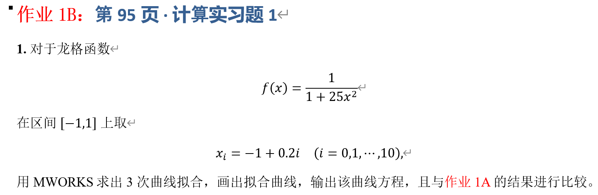
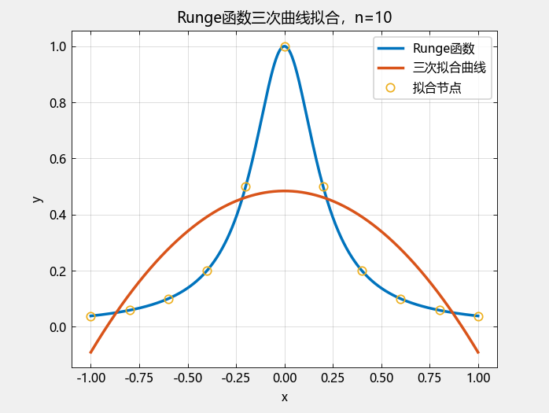
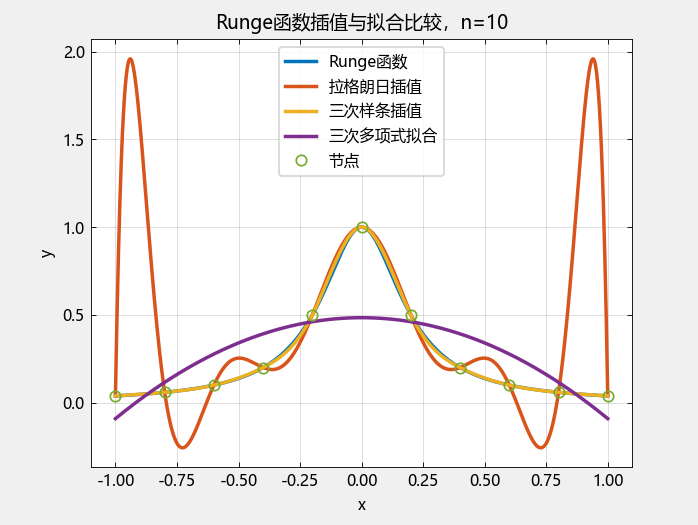

## 一、实验目的



## 2. 理论基础与推导

### 2.1 拟合问题

设函数 $f(x)$ 在区间 $[a,b]$ 上给定，选取 $n+1$ 个互不相同的节点 $x_0,x_1,\cdots,x_n$，并记节点处的函数值为 $y_i=f(x_i)$。拟合问题是在选定的函数类 $\mathcal Q$ 中寻找函数 $Q(x)$，使其尽可能接近数据点 $(x_i,y_i)$。 本实验采用最小二乘准则，即使所有节点处的残差平方和达到最小, $ \min_{Q\in\mathcal Q}\sum_{i=0}^{n}\left[y_i-Q(x_i)\right]^2 $

### 2.2 三次多项式最小二乘拟合

#### 2.2.1 拟合模型与目标函数

根据题目要求，在区间 $[-1,1]$ 上取 11 个等距节点

$$
x_i=-1+0.2i,\qquad y_i=\frac{1}{1+25x_i^2},\qquad i=0,1,\ldots,10.
$$

选取基函数 $1,x,x^2,x^3$，在次数不超过三次的多项式空间 $\mathcal P_3$ 中寻找拟合函数

$$
Q_3(x)=a_0+a_1x+a_2x^2+a_3x^3.
$$

该模型包含 4 个待定系数，而给定的数据点有 11 个。以所有节点处的残差平方和作为评价准则，并赋予各节点相同的权重，构造目标函数

$$
J(\mathbf a)=\sum_{i=0}^{10}\left(y_i-a_0-a_1x_i-a_2x_i^2-a_3x_i^3\right)^2,
\qquad \mathbf a=[a_0,a_1,a_2,a_3]^T.
$$

最小二乘拟合就是求使 $J(\mathbf a)$ 最小的系数向量。这里的目标函数衡量 11 个给定节点上的整体偏差，后续的最大绝对误差和 RMSE 则用于评价拟合函数在更密测试网格上的逼近效果。

#### 2.2.2 正规方程的推导

目标函数 $J$ 是关于各系数的二次函数。分别对 $a_j$ 求偏导并令其为零，得到

$$
\frac{\partial J}{\partial a_j}
=-2\sum_{i=0}^{10}x_i^j
\left(y_i-\sum_{k=0}^{3}a_kx_i^k\right)=0,
\qquad j=0,1,2,3.
$$

将待定系数移至等式左端，整理为

$$
\sum_{k=0}^{3}\left(\sum_{i=0}^{10}x_i^{j+k}\right)a_k
=\sum_{i=0}^{10}x_i^jy_i,
\qquad j=0,1,2,3.
$$

这四个方程构成关于 $a_0,a_1,a_2,a_3$ 的线性方程组。引入设计矩阵与观测向量

$$
A=\begin{bmatrix}
1&x_0&x_0^2&x_0^3\\
1&x_1&x_1^2&x_1^3\\
\vdots&\vdots&\vdots&\vdots\\
1&x_{10}&x_{10}^2&x_{10}^3
\end{bmatrix}\in\mathbb R^{11\times4},
\qquad
\mathbf y=\begin{bmatrix}y_0\\y_1\\\vdots\\y_{10}\end{bmatrix},
$$

则 $J(\mathbf a)=\|A\mathbf a-\mathbf y\|_2^2$，上述方程组可写为正规方程

$$
\boxed{A^TA\mathbf a=A^T\mathbf y.}
$$

令残差向量为 $\mathbf r=\mathbf y-A\mathbf a$，正规方程等价于 $A^T\mathbf r=0$，即

$$
\sum_{i=0}^{10}r_ix_i^j=0,\qquad j=0,1,2,3.
$$

因此，最优拟合的残差与设计矩阵的各列正交，$A\mathbf a$ 是数据向量 $\mathbf y$ 在 $A$ 的列空间上的正交投影。

#### 2.2.3 最小二乘解的存在性与唯一性

首先证明 $A$ 列满秩。若 $A\mathbf c=0$，则多项式 $c_0+c_1x+c_2x^2+c_3x^3$ 在 11 个互异节点上均为零。次数不超过三次的非零多项式至多有 3 个互异零点，故该多项式恒为零，从而 $\mathbf c=0$。因此 $\operatorname{rank}(A)=4$。

于是，对任意非零向量 $\mathbf c$，有 $\mathbf c^TA^TA\mathbf c=\|A\mathbf c\|_2^2>0.$

这说明 $A^TA$ 为对称正定矩阵，正规方程存在唯一解 $\mathbf a_*$。进一步，对任意增量 $\mathbf h$，利用 $A^T(A\mathbf a_*-\mathbf y)=0$，可得

$$
\begin{aligned}
J(\mathbf a_*+\mathbf h)
&=\|A\mathbf a_*-\mathbf y+A\mathbf h\|_2^2\\
&=J(\mathbf a_*)+\|A\mathbf h\|_2^2.
\end{aligned}
$$

当 $\mathbf h\ne0$ 时，$\|A\mathbf h\|_2^2>0$，故 $J(\mathbf a_*+\mathbf h)>J(\mathbf a_*)$。因此正规方程的解就是目标函数唯一的全局极小点。

#### 2.2.4 利用对称性求出拟合系数

本题节点满足 $x_{10-i}=-x_i$，且 Runge 函数为偶函数，因而 $y_{10-i}=y_i$。关于原点成对的节点使奇次幂之和及奇次加权和相消，即

$$
\sum_{i=0}^{10}x_i=\sum_{i=0}^{10}x_i^3=\sum_{i=0}^{10}x_i^5=0,
\qquad
\sum_{i=0}^{10}x_iy_i=\sum_{i=0}^{10}x_i^3y_i=0.
$$

记 $s_k=\sum_{i=0}^{10}x_i^k$、$b_k=\sum_{i=0}^{10}x_i^ky_i$。由节点值计算得到

$$
s_0=11,\quad s_2=4.4,\quad s_4=3.1328,\quad s_6=2.62592,
$$

$$
b_0\approx2.794570135746607,\qquad
b_2\approx0.328217194570136.
$$

于是正规方程化为

$$
\begin{bmatrix}
11&0&4.4&0\\
0&4.4&0&3.1328\\
4.4&0&3.1328&0\\
0&3.1328&0&2.62592
\end{bmatrix}
\begin{bmatrix}a_0\\a_1\\a_2\\a_3\end{bmatrix}
=\begin{bmatrix}b_0\\0\\b_2\\0\end{bmatrix}.
$$

该方程组分解为偶次项和奇次项两个独立的子系统。奇次项满足

$$
\begin{bmatrix}4.4&3.1328\\3.1328&2.62592\end{bmatrix}
\begin{bmatrix}a_1\\a_3\end{bmatrix}
=\begin{bmatrix}0\\0\end{bmatrix}.
$$

该系数矩阵是正定矩阵 $A^TA$ 的主子矩阵，因而非奇异，故 $a_1=a_3=0$。偶次项则满足

$$
\begin{bmatrix}11&4.4\\4.4&3.1328\end{bmatrix}
\begin{bmatrix}a_0\\a_2\end{bmatrix}
=\begin{bmatrix}b_0\\b_2\end{bmatrix}.
$$

其行列式为 $\Delta=11\times3.1328-4.4^2=15.1008$，因此

$$
a_0=\frac{3.1328b_0-4.4b_2}{15.1008}\approx0.484124924848907,
$$

$$
a_2=\frac{11b_2-4.4b_0}{15.1008}\approx-0.575182735816220.
$$

最终得到

$$
\boxed{Q_3(x)\approx0.484124924848907-0.575182735816220x^2.}
$$

这里的三次拟合是指在 $\mathcal P_3$ 中寻找最优多项式。由于函数与节点的对称性，最优解的奇次项系数为零，实际得到一个二次偶多项式。后续程序中一次项和三次项系数出现的 $10^{-16}$ 数量级数值，与这一理论结果相符。

## 3. 误差评价指标

为了定量比较三种方法，本实验采用最大绝对误差和均方根误差两个指标。

### 3.1 最大绝对误差

最大绝对误差定义为, $E_{\max}=\max_{x\in[-1,1]}|f(x)-\tilde f(x)|$.

其中 $\tilde f(x)$ 表示相应的插值函数或拟合函数。最大绝对误差能够反映整个区间中误差最大的情况，因此可以用于评价方法在最不利位置上的逼近性能。

### 3.2 均方根误差

在 1001 个测试点上计算均方根误差：

$$
RMSE=
\sqrt{
\frac{1}{N}
\sum_{i=1}^{N}
\left[f(x_i)-\tilde f(x_i)\right]^2
},\qquad N=1001
$$

RMSE 反映整个区间上的总体逼近误差。与最大绝对误差相比，它不只关注单个误差最大的点，因此将最大绝对误差与 RMSE 结合可以更加全面地评价不同方法的逼近性能。

## 4. 实验程序设计

实验程序主要包含两个部分，即三次曲线拟合求值和对比实验，

### 4.1 三次曲线拟合

```julia
using LinearAlgebra
using TyPlot

# =========================
# 1. Runge函数
# =========================
function f(x)
    return 1.0 / (1.0 + 25.0 * x^2)
end


# =========================
# 2. 取 n = 10
# =========================
n = 10

# 将 [-1,1] 分成10个区间，共11个节点
nodes = collect(range(-1.0, 1.0, length=n + 1))

# 节点函数值
values = [f(x) for x in nodes]


# =========================
# 3. 三次多项式最小二乘拟合
#
# p(x) = a0 + a1*x + a2*x^2 + a3*x^3
# =========================

A = hcat(
    ones(length(nodes)),
    nodes,
    nodes.^2,
    nodes.^3
)

# 最小二乘求解
a = A \ values

a0 = a[1]
a1 = a[2]
a2 = a[3]
a3 = a[4]


# =========================
# 4. 输出拟合系数
# =========================

println("==============================")
println("Runge函数三次曲线拟合")
println("==============================")

println("a0 = ", a0)
println("a1 = ", a1)
println("a2 = ", a2)
println("a3 = ", a3)

println()
println("拟合曲线方程：")

println(
    "p(x) = $(a0) + ($(a1))x + ($(a2))x^2 + ($(a3))x^3"
)


# =========================
# 5. 定义拟合函数
# =========================

function p(x)
    return a0 + a1*x + a2*x^2 + a3*x^3
end


# =========================
# 6. 生成绘图数据
# =========================

x_plot = collect(range(-1.0, 1.0, length=1001))

# Runge原函数
y_true = [f(x) for x in x_plot]

# 拟合函数
y_fit = [p(x) for x in x_plot]


# =========================
# 7. 绘图
# =========================

TyPlot.figure()

# Runge函数
TyPlot.plot(
    x_plot,
    y_true,
    linewidth=2,
    label="Runge函数"
)

TyPlot.hold("on")

# 三次拟合曲线
TyPlot.plot(
    x_plot,
    y_fit,
    linewidth=2,
    label="三次拟合曲线"
)

# n=10的节点
TyPlot.plot(
    nodes,
    values,
    "o",
    label="拟合节点"
)

TyPlot.title("Runge函数三次曲线拟合，n=10")
TyPlot.xlabel("x")
TyPlot.ylabel("y")
TyPlot.legend()
TyPlot.grid(true)

TyPlot.hold("off")
```

### 4.2 对比实验

> 由于篇幅限制，此处只展示重要的算法程序。

```julia
# ============================================================
# 6. 最大绝对误差
# ============================================================
function max_error(y_true, y_approx)

    return maximum(
        abs.(y_true .- y_approx)
    )

end


# ============================================================
# 7. 均方根误差 RMSE
# ============================================================
function rmse(y_true, y_approx)

    return sqrt(
        mean(
            (y_true .- y_approx).^2
        )
    )

end

# ============================================================
# 15. 计算最大绝对误差
# ============================================================

max_lagrange =
    max_error(
        y_true,
        y_lagrange
    )

max_spline =
    max_error(
        y_true,
        y_spline
    )

max_fit =
    max_error(
        y_true,
        y_fit
    )


# ============================================================
# 16. 计算RMSE
# ============================================================

rmse_lagrange =
    rmse(
        y_true,
        y_lagrange
    )

rmse_spline =
    rmse(
        y_true,
        y_spline
    )

rmse_fit =
    rmse(
        y_true,
        y_fit
    )


# ============================================================
# 17. 输出误差结果
# ============================================================

println()
println("============================================")
println("误差比较")
println("============================================")

println()
println("拉格朗日多项式插值：")
println(
    "最大绝对误差 = ",
    max_lagrange
)
println(
    "RMSE = ",
    rmse_lagrange
)

println()
println("三次样条插值：")
println(
    "最大绝对误差 = ",
    max_spline
)
println(
    "RMSE = ",
    rmse_spline
)

println()
println("三次多项式拟合：")
println(
    "最大绝对误差 = ",
    max_fit
)
println(
    "RMSE = ",
    rmse_fit
)
```

## 5. 实验结果

### 5.1 三次多项式拟合结果

程序计算得到三次多项式拟合系数：

$$
a_0=0.4841249248489067,\qquad
a_1=-1.1179537773642428\times10^{-16}
$$

$$
a_2=-0.5751827358162201,\qquad
a_3=2.0238107130454286\times10^{-16}
$$

因此计算机直接得到的三次拟合方程为：

$$
Q_3(x)=
0.4841249248489067
-1.1179537773642428\times10^{-16}x
-0.5751827358162201x^2
+2.0238107130454286\times10^{-16}x^3
$$

其中一次项和三次项的系数均为 $10^{-16}$ 数量级，可以认为是浮点数运算产生的舍入误差。因此最终的三次拟合曲线可以简化为：

$$
\boxed{Q_3(x)\approx0.484125-0.575183x^2}
$$

结果图如图所示

出现这一结果与 Runge 函数及节点的对称性有关。由于 $f(-x)=f(x)$，Runge 函数是偶函数，同时本实验的 11 个节点关于原点完全对称，因此理论上最小二乘拟合得到的奇次项系数应满足 $a_1=a_3=0$。程序得到的 $10^{-16}$ 数量级结果与理论分析一致。

### 5.2 三种方法的误差结果

在区间 $[-1,1]$ 上取 1001 个测试点，根据程序输出，可以将三种方法的误差整理如下：


| 方法               |         最大绝对误差 |                RMSE |
| ------------------ | -------------------: | ------------------: |
| 拉格朗日多项式插值 |   1.9156430502192499 |  0.5800915309240636 |
| 自然三次样条插值   | 0.021973825749581732 | 0.00715439086338398 |
| 三次多项式拟合     |   0.5158750751510933 | 0.19715203239675028 |

最大绝对误差反映三种方法在最不利位置上的误差大小，而 RMSE 反映整个区间的总体逼近情况,从图像上也可以直观看到这三种方法的运行结果和其逼近效果。


## 6. 实验结论

本实验针对 Runge 函数 $f(x)=1/(1+25x^2)$，在区间 $[-1,1]$ 上取 $n=10$，即 11 个等距节点，分别进行了拉格朗日多项式插值、自然三次样条插值以及三次多项式最小二乘拟合，并通过函数图像、最大绝对误差和 RMSE 对三种方法进行了比较。

拉格朗日插值能够严格通过全部节点，但使用等距节点进行较高次数的全局多项式插值时，在区间端点附近出现明显振荡，体现了典型的 Runge 现象。该结果说明，对于某些函数而言，增加等距节点和提高插值多项式次数并不一定能够改善整体逼近效果。

自然三次样条插值同样能够严格通过全部节点，但采用分段三次多项式进行局部逼近，因此避免了使用单个高次全局多项式所带来的严重端点振荡，同时能够保证函数及其一阶、二阶导数的连续性，表现出较好的平滑性和局部稳定性。

三次多项式最小二乘拟合得到 $Q_3(x)\approx0.484125-0.575183x^2$，其中奇次项系数接近于 0，与 Runge 函数及等距节点关于原点对称的性质一致。三次拟合曲线整体平滑，不存在高次插值导致的 Runge 振荡，但由于模型次数较低，对 Runge 函数在 $x=0$ 附近的尖峰描述能力有限，说明没有明显振荡并不代表具有更高的逼近精度。

综合实验结果可以看出，**高次全局多项式插值、分段低次样条插值和低阶最小二乘拟合具有不同的数值特性和适用目标**。在实际应用中，应根据是否要求严格经过数据点、函数局部变化特征、逼近精度要求以及数值稳定性等因素选择合适的方法，而不能简单地以多项式次数或曲线平滑程度作为判断依据。
